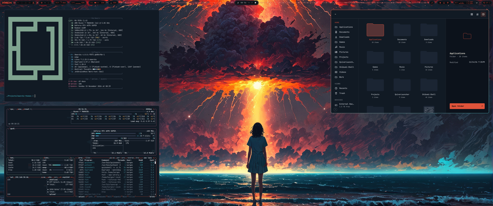

# Omarchy Abstract Thoughts Theme

Abstract Thoughts is a dark palette sampled directly from the *My Abstract Thoughts* wallpaper: a deep navy background from the night sky and sea, a fiery red-orange accent from the burning clouds, teal-cyan from the glowing horizon, gold from the light beam, and a warm cream foreground from the sun. Gaps and animations are matched to the Primrose theme (`gaps_in = 2`, `gaps_out = 2`).

## Preview



## Install

```bash
omarchy theme install https://github.com/Korgen-Jurai/omarchy-abstract-thoughts-theme.git
```

## What's included

- Terminal palette (`colors.toml`) — drives Alacritty, Kitty, Foot, Ghostty, btop, VS Code, Obsidian, and more via Omarchy's built-in templates
- Hyprland gaps/borders/animations (`hyprland.lua`)
- Wallpaper (`backgrounds/1-my-abstract-thoughts.jpg`)

## Wallpaper


